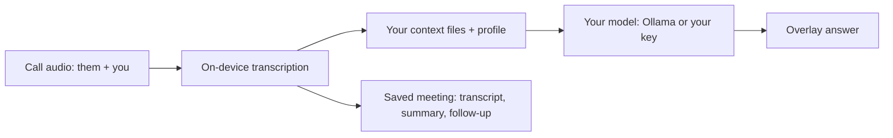

<h1 align="center">InterviewAI</h1>

<p align="center">
  
  
  
  <a href="https://github.com/splashdeluxe/InterviewAI/releases/tag/v1.2.0"></a>
  <a href="https://github.com/splashdeluxe/InterviewAI/stargazers"></a>
</p>

<p align="center">
A free, native Mac copilot for interviews and meetings. It listens to both sides of the call, transcribes everything on your Mac, and suggests answers grounded in your own files.
</p>

<p align="center">⭐ <strong>If InterviewAI helps you, a star helps the next person find it.</strong></p>

<p align="center">
<a href="https://github.com/splashdeluxe/InterviewAI/releases/tag/v1.2.0">Release 1.2.0</a> · <a href="#quick-start">Quick start</a> · <a href="#what-it-does">What it does</a> · <a href="#privacy">Privacy</a> · <a href="#report-a-bug">Report a bug</a> · <a href="#faq">FAQ</a> · <a href="https://github.com/splashdeluxe/InterviewAI/issues">Issues</a>
</p>

---

## What this is

An original Swift app for macOS. No account, no licence key, no trial, no quota, no store. There is no paywall in this app, because none was written. You build it from source in one command, and it runs on your Mac with your own model: Ollama on the machine, or any OpenAI-compatible endpoint with your own key.

**Core capabilities:**

- **Both sides, live** - System audio (them) and your microphone (you) transcribed at the same time, on device. Nothing is recorded.
- **Answers while you talk** - Auto Answer speaks up when a question settles, or run the action row yourself: What Should I Say, Clarify, Recap, Follow-Up, Answer, Code Hint, Brainstorm, on ⌘1 to ⌘7.
- **A floating overlay** - A borderless panel over Zoom, Teams, or Meet with the live transcript, the streaming answer, and an ask box. ⌘⇧H shows or hides it, ⌘⇧S attaches a screenshot of the front window.
- **Your phone as a second screen** - Turn on Phone Display in Settings and the session appears in your phone browser on the same Wi-Fi: the live answer, the conversation, and the action buttons, whose taps work like ⌘1 to ⌘7. The overlay stays off your shared screen, and nothing leaves your local network.
- **Grounded in your files** - Add your resume, the job description, and your notes on the Context page. Pinned files go into every answer; the rest rank by keyword match, locally.
- **A profile for the role** - One structured profile with your sources, standing instructions for every answer, talking points with honest gap answers, company intel, and a cover letter.
- **Meetings that keep themselves** - Every finished call is saved with transcript, notes, a summary, and a follow-up draft. Ask searches your meetings and context files, on the Mac.
- **Nine modes, plus your own** - General, Technical Interview, Looking for Work, Behavioral, Negotiation, Sales, Recruiting, Team Meet, Lecture, and custom modes with their own context.
- **Calendar, read-only** - Upcoming meetings on the Live page, one click to start. Saved meetings take the event title and attendee list. It never writes to your calendar.

## Quick start

Fastest: download **InterviewAI-1.2.0.dmg** from the [release page](https://github.com/splashdeluxe/InterviewAI/releases/tag/v1.2.0), open it, drag the app into Applications, and right-click it once to choose Open (the app is unsigned, so macOS asks the first time).

Or build from source. That needs macOS 14 or later and Xcode installed (for the Swift toolchain). You never open Xcode.

```bash
git clone https://github.com/splashdeluxe/InterviewAI.git
cd InterviewAI
./build.sh --open
```

Then, in the app:

1. **Settings, Providers** - Leave Ollama (run `ollama pull llama3.2:1b` first), or pick your endpoint and key and press Test Connection. Keys live in the Keychain.
2. **Settings, Permissions** - Grant Microphone, Speech Recognition, and Screen Recording. Screen Recording is how system audio is heard.
3. **Settings, Speech** - Parakeet Ultra is the default engine and downloads its model once. Whisper and Apple Speech are the alternatives.
4. **Context page** - Add your resume and the job description.
5. **Live page** - Start Listening, or press ⌘⇧H for the overlay.

Building from the command line instead: `./build.sh` installs the app into your Applications folder. The test suite runs with `swift test`.

## How it works



1. **Listen** - ScreenCaptureKit takes the system audio, AVAudioEngine takes your microphone.
2. **Transcribe** - Parakeet Ultra (default, 25 European languages), Whisper (more languages, Indonesian among them), or Apple Speech, all on the Mac.
3. **Answer** - The prompt carries the transcript, your pinned context, and your profile. It goes to Ollama on your machine, or to the endpoint you chose.
4. **Save** - When the call ends, the meeting is stored locally with its summary and follow-up draft.

Optional, in Settings, Speech: translate each line as it lands (English, German, Russian, Indonesian, Spanish) through your provider, and label the other side's speakers in saved meetings.

## Privacy

Audio is transcribed on your Mac and never recorded. Meetings and context files live in a local store on the Mac. The only data that leaves the machine is the prompt sent to the provider you chose, and a bug report if you write one and press Submit. There is no analytics, no tracking, and no account to create.

## Report a bug

In the app: the menu at the foot of the sidebar, then Report an Issue. Write what went wrong, capture a screenshot if it helps, and press Submit. The report is filed as an issue in this repo by a small relay, so the app holds no token and there is nothing to set up. The app version, macOS version, and engine ride along on their own.

## FAQ

**What does it cost?**
Nothing. The app is MIT-licensed and free. If you use a paid API endpoint, that provider bills you; Ollama on your Mac is free.

**Do I need an account?**
No. There is no sign-up anywhere in the app.

**Which languages does transcription cover?**
Parakeet Ultra covers 25 European languages and is the fastest. Whisper covers more, including Indonesian. Apple Speech depends on your macOS language packs.

**Is my call recorded?**
No. Audio is transcribed in memory and never written to disk. The transcript, notes, and summary are saved as text, on your Mac.

**Does it work on Windows?**
No. InterviewAI is a native macOS app and uses Mac-only frameworks for system audio.

**Where is the download?**
On the [release page](https://github.com/splashdeluxe/InterviewAI/releases/tag/v1.2.0): InterviewAI-1.2.0.dmg, about 19 MB. Building from source with `./build.sh --open` works too.

## Support

InterviewAI stays free because I fund the hosting and tooling myself. If it saved you time, the easiest support is a star at the top of this page. A coffee works too:

[](https://ko-fi.com/nils_effmert)

## Licence

MIT. See [LICENSE](LICENSE). InterviewAI is an original app, written from scratch by Nils Effmert. It contains no third-party app code, text, prompts, icons, or branding.
